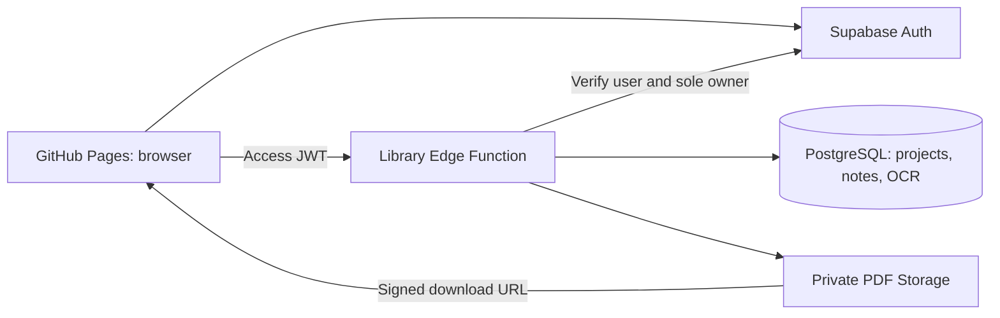

# Margin

A private PDF reading and notes library, built for Traditional Chinese textbooks and notes in Chinese, Vietnamese, and English.

**Site:** https://baole106.github.io/pdf-note/

## Features

- Import each PDF as a project; reopen its saved page and zoom.
- Each open document has a refresh-safe `#/pdf/<project-uuid>` URL. Refreshing or using browser Back/Forward restores the matching private document.
- Select text to open **Copy · Note · Text box · Close**. Saving a note persists its highlight and selected passage.
- Toggle **Text box** on, click or tap anywhere to place as many boxes as needed, then toggle it off or press Escape. Type in the default blue, drag from the top grip, resize from the bottom-right corner, choose black/red/blue text, or change its text size without modifying the original PDF. Textboxes use a compact light border, with editing controls shown only on hover or focus. A textbox can also be linked to selected text.
- Add standalone notes, edit passages and notes, choose highlight colors, search or filter by note type/color, and export UTF-8 Markdown.
- Responsive reader and notes drawer for mobile browsers.
- PDF.js character maps and fonts for CJK PDFs.
- Optional on-device OCR for scanned pages: Traditional Chinese, vertical Traditional Chinese, Vietnamese, and English. Recognized word positions persist with the project. OCR can make mistakes; passages remain editable.
- Supabase password login, access tokens, automatic refresh-token rotation, and logout. No registration; one owner account.

## Stack

The frontend is plain HTML, CSS, and JavaScript in `web/`. Dependencies use pinned CDN URLs: PDF.js 4.10.38, Supabase JS 2.57.4, Interact.js 1.10.28, and lazily loaded Tesseract.js 6.0.1. There is **no npm install, frontend framework, or build step**. Google Fonts is optional; system fonts provide fallbacks.

GitHub Actions publishes only `web/` to GitHub Pages. Supabase provides Auth, PostgreSQL, private Storage, and one TypeScript/Deno Edge Function (`library`). Browser data operations go through the Edge Function; authentication uses the official Auth client, and PDFs download through short-lived signed Storage URLs.



## Security

- Passwords and service credentials never belong in frontend files or Git.
- `web/config.js` contains only the public project URL, public anon key, and internal email alias for the username.
- Public registration is disabled in the hosted Auth configuration. The login form maps `BaoLe106` to its internal Auth email alias.
- The API verifies every JWT with `auth.getUser()` and checks the sole account in `app_owner`.
- Every document operation checks ownership. Notes and OCR are scoped to an owned document.
- Document URLs contain only a project UUID. Loading one still requires the Edge Function to validate the JWT and project owner before returning a short-lived private Storage URL; possessing the URL alone grants no PDF access.
- All application tables enable RLS and revoke direct `anon` / `authenticated` access. No client Storage policies exist; the PDF bucket is private.
- Function gateway `verify_jwt = false` is intentional: validation occurs inside the handler and supports Supabase's current signing keys. It does **not** allow unauthenticated data access.
- CORS permits the deployed Pages origin and local development origins. Saved user text is rendered using `textContent`.

## Free plan and limits

The deployed Supabase organization uses Free, and GitHub Pages serves the public source repository. PDFs, notes, homework, and answers remain private. PDF-page OCR runs locally. Chinese practice uses the separately billed OpenAI API for exercise generation, answer feedback, and a small number of image readings.

- Application upload limit: **100 MiB per PDF** (shown as 100 MB). Larger files are rejected before reading or uploading, with an error popup.
- An upload progress bar shows the filename, percentage, and checking/uploading/saving stages. Transferred bytes drive the percentage for both regular and large uploads.
- PDFs larger than 40 MiB upload as private 8 MiB parts through the Edge Function. The browser reassembles them when opening; each stored object stays within Supabase Free's 50 MB object limit. Existing PDFs keep their original storage format.
- Large uploads reserve their full size against the library quota. Failed uploads are cleaned up; if a tab closes mid-upload, the interrupted project remains visible and can be deleted to reclaim storage.
- Library PDF cap: **950 MiB**, enforced transactionally by PostgreSQL, below the 1 GB Storage allocation.
- Notes: 20,000 characters per passage and 50,000 per note; OCR: 10,000 words per page.
- Supabase Free includes a 500 MB database and 1 GB Storage; bandwidth and function quotas also apply. Free projects can pause after inactivity, requiring restoration from the dashboard. Check [current Supabase plan limits](https://supabase.com/pricing).
- OCR accuracy depends on scan quality, typeface, and layout. Vertical writing and mixed columns can have imperfect reading order. OCR runs one page at a time to limit mobile memory usage.
- Encrypted PDFs must have their password removed before import. Internet access is needed for authentication, saving, downloads, and CDN dependencies. This version is not an offline app.

## Chinese expression practice

Open `homework.html` or choose **Chinese practice** from the library. The same Supabase login protects both pages. There is no microphone, recording, or voice mode.

- Each 14-day cycle contains 60 typed exercises, five each in 12 formats: everyday replies, organizing ideas, reading/responding, rewriting, storytelling, opinions, dialogue, summarizing, tone, comparison, clarification, and transfer. The emphasis is clear ideas and natural conversational Traditional Chinese.
- Guidance and feedback include Traditional Chinese and English. Every exercise supplies optional vocabulary, usage examples, and source labels. Source terms are checked against the captured material before publication.
- Drafts save to the account. Revision numbers prevent conflicting tabs overwriting newer work. Reviewed attempts are retained separately; completion is an explicit learner action. Feedback scores are tentative writing-coaching signals, not spoken fluency measurements.
- Cycles start on the first visit/import date in Asia/Taipei and recur every 14 days. Supabase Cron invokes the worker every five minutes; opening the page also resumes preparation. One database lease per owner prevents concurrent generation. Five questions are committed at a time; three consecutive failures pause a cycle until Retry is selected.
- Each course freezes a source snapshot and prompt/model version. Later source updates apply to future courses. Previous answers' next-step feedback informs generation. Only selected excerpts are sent per batch, not entire PDFs.
- AI requests have a database-enforced limit of 80 per UTC day, including failed requests, plus output and timeout limits. Default models are `gpt-4.1` for exercises/feedback and `gpt-4.1-mini` for vision; configure `HOMEWORK_MODEL` and `HOMEWORK_VISION_MODEL` in Supabase to change them. Token usage is recorded in `practice_usage`.

`scripts/sync_practice_sheet.py` reads all visible tabs in the configured public Google Sheet, preserving row and embedded-image references. The daily GitHub Actions workflow extracts every embedded image with Tesseract (`chi_tra+eng+vie`), uses OpenAI vision for at most three new images, and caches results by SHA-256. OCR text is explicitly marked uncertain. The raw workbook and images are temporary runner files and are not uploaded to Supabase Storage or committed to Git. Failed images remain pending for the next run. The source tab lists import counts; suggested vocabulary lists the words used in the selected course.

Required secrets:

- Supabase: `OPENAI_API_KEY`, `HOMEWORK_WORKER_SECRET`.
- GitHub Actions: the same `HOMEWORK_WORKER_SECRET` for source import only. The OpenAI key stays in Supabase.
- Supabase Vault: `homework_worker_secret`, used by the private scheduled worker. The public anon key cannot invoke importer actions.

Apply `supabase/migrations/202611220001_practice.sql`, then deploy `homework` with the CLI. Configure the `margin-practice-worker` Cron job to POST to `/functions/v1/homework?action=work` with the Vault secret in `x-worker-secret`, a JSON `{}` body, and a 120-second HTTP timeout. The production Cron schedule is `*/5 * * * *`. Free project pausing can interrupt scheduled work; the page resumes generation once the project is available again. The sheet import can also be run manually from GitHub Actions.

Verification: `deno test tests/practice_core_test.ts` checks format coverage and content validation; `uv run --with playwright python3 tests/practice_browser.py` (with `web/` served on port 8000 and Chrome available) exercises typed answers, bilingual help, feedback, safe text rendering, saving, stale-draft protection, navigation, and responsive layouts against mocked HTTP responses.

## Local development

```sh
python -m http.server 8000 --directory web
```

Open http://localhost:8000. Public connection settings are already in `web/config.js`. The frontend can use the hosted backend; sign in with the owner credentials.

Backend source:

```text
supabase/migrations/202609150001_library.sql
supabase/migrations/202609150002_large_pdfs.sql
supabase/functions/library/index.ts
supabase/config.toml
```

Deploy an updated function with an authenticated Supabase CLI:

```sh
supabase functions deploy library --project-ref etyubwsyrfzteckfmhtt --use-api
```

The listed library migrations and the practice migration have already been applied. Do not rerun them on the existing database; add a new migration for schema changes. The deployed owner was provisioned through the Auth Admin API and inserted into `app_owner`. The account password is intentionally absent from this repository.

## Verification

Development-only browser checks require Python packages; they do not affect frontend hosting:

```sh
python -m pip install playwright pymupdf
python -m playwright install chromium
# Set PDF_NOTE_PASSWORD in your terminal environment, then:
python tests/browser_smoke.py
# Safari engine / touch viewport:
python -m playwright install webkit
python tests/mobile_webkit.py
```

Set `PDF_NOTE_TEST_OCR=1` to include a real on-device OCR check; optionally set `PDF_NOTE_TEST_URL` to test the deployed site. The suite creates a multilingual test PDF, exercises the live API, then deletes its test project. Screenshots go to ignored `test-results/`.

`python tests/large_upload.py` checks the 100 MiB boundary, over-limit popup, large-upload retry, byte-for-byte signed downloads, and reopening notes. It transfers several hundred MB against the configured backend and removes its test project afterward.

The checks cover login, PDF upload/rendering, Chinese selection, the selection popover, Unicode notes, saved highlights/page/zoom, editing, Markdown export, mobile layouts, token refresh, deletion, and logout. Browser emulation checks narrow viewports; it does not replace testing on a physical iPhone.

## References

- [PDF.js examples and character maps](https://mozilla.github.io/pdf.js/examples/)
- [Tesseract.js API](https://github.com/naptha/tesseract.js/blob/master/docs/api.md)
- [Supabase Edge Function authentication](https://supabase.com/docs/guides/functions/auth)
- [Supabase Storage file limits](https://supabase.com/docs/guides/storage/uploads/file-limits)
